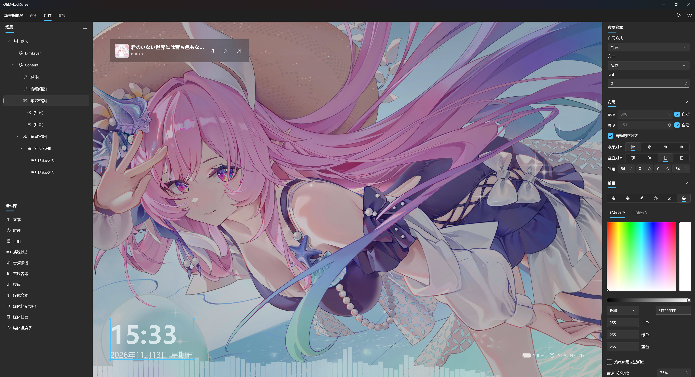

# OhMyLockScreen

> [!caution]
> 本应用还在早期实验阶段，可能会出现不稳定的情况，请谨慎在主力设备上使用。

> 你的锁屏，如你所想

OhMyLockScreen 是一款适用于 Windows 的锁屏自定义工具，可以实现在不替换系统文件和注入系统进程的前提下干净地自定义系统锁屏界面。本应用基于 .NET 10 + UWP 构建。

OhMyLockScreen 不能——且以后也不会——替换或修改锁屏后的登录界面。

## 功能

- [x] 直观的编辑界面
- [x] 自定义锁屏页面为你喜欢的样子
- [x] 设置动态锁屏壁纸
- [x] 通过组件系统自由组合锁屏界面的元素
- [x] 通过特性系统为界面元素应用各种各样的样式
- [ ] 更多功能正在开发中……

## 开始使用

> 等微软商店审核完后补充

## 开发

### 开发环境

- 在 Windows 上安装 Git 和 .NET 10 SDK，并开启开发人员模式。
- 安装 Visual Studio 2026，选择「WinUI 应用程序开发」工作负载，并勾选以下组件。安装详情请参阅[微软 UWP 开发环境文档](https://learn.microsoft.com/zh-cn/windows/uwp/dotnet-native/modernize-uwp-apps-with-dotnet)。
  - UWP 工具
  - Windows 11 SDK（`10.0.26100.0`）
  - C++ UWP 工具（含 VC++ v14 UWP 运行库及 x86/x64 MSVC 工具）

### 运行项目

1. 克隆仓库后，用 Visual Studio 打开 `OhMyLockScreen.slnx`，将 `OhMyLockScreen` 设为启动项目。
2. 选择 `Debug | x64`（也支持 `x86`），按 `F5` 部署并运行。
3. 如果部署提示缺少签名证书，请在主项目的打包设置中创建并选择本地测试证书，证书主题须与 `Package.appxmanifest` 中的 `Publisher` 一致。
4. 如需测试系统锁屏，请在应用的【设置】→【通用】中开启「替换系统锁屏实现」，再按 `Win + L`。修改代码后，请重新部署再测试。

## 常见问题

### 1. 可以修改登录界面吗？就是要我输密码/PIN 的那个？

答：不能。Windows 提供的接口能且仅能修改登录前的锁屏页面。修改系统登录认证界面不是本应用的开发目标，以后也不会加入到本应用中，

### 2. 我被卡在锁屏进不了登录界面了怎么办？

答：按 <kbd>Ctrl</kbd>+<kbd>Alt</kbd>+<kbd>Del</kbd> 以强制解锁，进入登录界面。

### 3. 怎么恢复系统锁屏？

答：在应用设置（编辑器右上角的齿轮）的通用页面中，关闭【替换系统锁屏】选项即可。

### 4. 怎么彻底卸载？卸载后会有残留吗？

答：首先按上一问的方法恢复系统锁屏，然后在系统设置直接卸载即可。由于本应用对系统的修改仅限于用户注册表中声明的锁屏提供者值，所以在按此步骤操作的情况下，一般不会留下残留。

> [!note]
> 由于直接卸载不会清除注册表，且 explorer 存在缓存特性，在没有恢复系统锁屏的情况下卸载应用可能会导致在注销前锁屏均无法使用，一般重启后就会回退到默认锁屏。如果您被困在了锁屏界面，可按照第一问的方式脱困。

> [!warning]
> 卸载应用将抹除包括但不限于场景配置等所有应用数据文件。

## 许可证

本项目基于 [GPLv3](./LICENSE) 获得许可。
